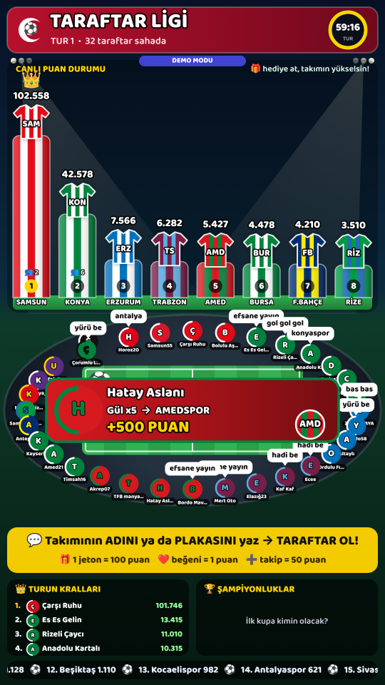

# ⚽ Taraftar Ligi — TikTok Canlı Yayın Oyunu

İzleyiciler yoruma **takımının adını ya da plakasını** yazar, taraftar olur ve stadyumun etrafında yerini alır.
Hediye attıkça, beğendikçe takımının forması yükselir. Tur bitince en yüksekteki takım **şampiyon** olur ve kupa kazanır.
Galatasaray, Fenerbahçe, Beşiktaş, Trabzonspor'un yanında Sivas'tan Amed'e, Bursa'dan Erzurum'a **50 Türk kulübü** var.



## Nasıl oynanır (izleyici gözünden)

| İzleyici ne yapar | Ne olur |
|---|---|
| Yoruma `trabzon`, `ts`, `61`, `cimbom`, `fener`, `sivas`, `58`, `amed`… yazar | O takımın taraftarı olur, stadyumda profil fotoğrafıyla belirir (+10 puan) |
| Hediye atar | 1 jeton = 100 puan takımına gider, ekranda “GOL!” ve kart çıkar |
| Beğenir | Her beğeni 1 puan |
| Takip eder / paylaşır | +50 puan |
| Takımı yokken hediye atar | Puan bekletilir, takımını yazınca eklenir |
| Başka takıma geçmek ister | Sadece yeni takımın adını yazar (ör. `gs`) — “transfer” olur |

- Lider değişince ekranda **“ZİRVE DEĞİŞTİ!”** çıkar.
- Tur süresi dolunca (varsayılan 60 dk) şampiyon ekranı gelir, takımın kupa sayısı artar, puanlar sıfırlanır, yeni tur başlar.
- Kupalar, taraftarların takımı ve devam eden tur `data/state.json` dosyasına kaydedilir. Program kapanıp açılsa da kaldığı yerden devam eder.

## En kolay yol: Tablet + ücretsiz Render (bilgisayar yok, ücret yok)

Oyun tabletin tarayıcısında çalışır. Puanlar, kupalar ve taraftarlar tabletin hafızasında saklanır.
TikTok'tan gelen yorum ve hediyeleri ücretsiz bir bulut sunucusu (Render) **aktarır**. Sunucu sadece postacıdır, hiçbir şey saklamaz.

**Bir kerelik kurulum (tabletten, 5 dakika):**

1. [render.com](https://render.com) adresinde GitHub hesabınla ücretsiz kaydol.
2. Şu bağlantıyı aç: **https://render.com/deploy?repo=https://github.com/haydarsahin0/tiktok**
3. `RELAY_USERS` kutusuna TikTok kullanıcı adını yaz (başkaları senin sunucunu kullanamasın) → **Apply / Deploy**.
4. Birkaç dakika sonra Render sana bir adres verir, ör. `https://taraftar-ligi.onrender.com`.

**Her yayında:**

1. Tablette Render adresinin sonuna `/ayarlar.html` ekleyip aç (ör. `https://taraftar-ligi.onrender.com/ayarlar.html`).
2. TikTok kullanıcı adını yaz → **Aktarıcıyı test et** → **Kaydet**.
3. Açılan yayın ekranında Paylaş menüsü → **Ana Ekrana Ekle**.
4. TikTok → **Canlı** → **Mobil oyun / Ekran paylaşımı** → yayını başlat → Taraftar Ligi'ne geç.
5. **Rahatsız Etmeyin** modunu aç, otomatik kilidi kapat, tableti şarja tak.

Notlar:
- Render'ın ücretsiz sunucusu 15 dakika kimse kullanmayınca uyur. İlk açılışta uyanması ~1 dakika sürebilir. Yayın ekranı açıkken sunucuyu 4 dakikada bir dürterek uyanık tutar.
- Kullanıcı adına `test` yazarsan aktarıcı sahte izleyiciler gönderir. Kurulumu yayın açmadan denemek için kullanabilirsin.
- Ayarlar sayfasında test butonları da var (hediye at, turu bitir…). Yayın ekranı başka sekmede açıkken çalışırlar.

**Tam ekran:** Yayın ekranına dokununca adres çubuğu gizlenir (Android, iPad). iPhone Safari buna izin vermez; iPhone'da **Paylaş → Ana Ekrana Ekle** yapıp ana ekrandaki simgeden aç, o zaman adres çubuğu hiç çıkmaz.
Ana ekran uygulaması kendi ayrı hafızasını kullanır, ayarları bir kez de orada gir.
Yayın ekranındayken ayarlara dönmek için **sol üst köşeye 3 kez hızlıca dokun** (ekranda buton görünmez).

**Yayını bitirirken (izleyiciler ekranını görmesin):**
1. **Sağ üst köşeye 3 kez hızlıca dokun** → "Bugünlük bu kadar! Takip et" kapanış kartı açılır (tekrar 3 dokunuş kapatır; mola için de kullanılabilir).
2. Ekran paylaşımını telefondan durdur: iPhone'da sol üstteki kırmızı kayıt simgesi → **Durdur** (ya da Denetim Merkezi → kayıt → Yayını Durdur); Android'de bildirim panelindeki ekran paylaşımı bildirimi → **Durdur**.
3. TikTok'a dön ve yayını bitir.
- Bağlantı sorunu olursa yayın ekranının adresine `?debug=1` ekle; gelen veriler ekranda görünür.

**Render otomatik güncellenmiyorsa:** Render'ın GitHub uygulamasının bu depoya erişimi yoksa güncellemeler gelmez. İki çözüm:
- Render → **Account Settings** → **GitHub** → **Configure** → `haydarsahin0/tiktok` deposuna erişim ver. Sonra servis → **Settings** → *Auto-Deploy*: **On Commit**.
- Ya da: Render → servis → **Settings** → **Deploy Hook** adresini kopyala → GitHub → depo → **Settings** → **Secrets and variables** → **Actions** → **New repository secret** → adı `RENDER_DEPLOY_HOOK`, değeri kopyaladığın adres. Bundan sonra her güncellemede GitHub, Render'a haber verir.
- Acil durumda: Render → servis → **Manual Deploy** → **Deploy latest commit**.

**İstersen Euler Stream ile:** Ayarlar sayfasında "Euler Stream" seçip ücretli API anahtarını yazabilirsin. Bu durumda Render gerekmez, oyun GitHub Pages'ten de açılabilir: `https://haydarsahin0.github.io/tiktok/`
(GitHub → Settings → Pages → *Deploy from a branch* → `gh-pages` / root.)

## ⚽ Maç Günü modu (futbol ligi varsayılanı)

Gerçek **Trendyol Süper Lig 2026-27** puan durumundan ve fikstüründen devam eden bir "Taraftar Ligi":

- Başlangıç: Vikipedi'deki gerçek sonuçlardan (7 Kasım 2026 güncellemesi) hesaplanan puan durumu. Örn. Galatasaray 28, Amed 23, Trabzonspor 22.
- İlk maç günü 11. haftanın oynanmamış 4 maçı (Beşiktaş–Gençlerbirliği, Çorum–Fenerbahçe, Alanya–Trabzonspor, Rizespor–Erzurumspor), sonra 12., 13. ... haftalar gerçek fikstür sırasıyla.
- Bundan sonraki her sonucu **oyun belirler**, gerçek sonuçlar değil; tablo oyunun maçlarıyla ilerler. 34. hafta bitince sezon şampiyonu ilan edilir ve aynı fikstürle yeni sezon başlar.
- Her maç günü: haftanın tüm maçları aynı anda, **6 tur x 25 dakika**.
- İzleyici takımının adını yazar; hediye, beğeni ve takip o turda takımına **baskı puanı** olarak gider.
- Tur sonunda maçta toplam en az **500 puan** varsa: **%65+** alan takım **gol** atar, **%85+** alırsa **2 gol**.
- Büyük dörtten biri (GS, FB, BJK, TS) Anadolu takımıyla oynuyorsa Anadolu takımının puanı **x1,5** sayılır.
- Maç bitince 3/1/0 puanla tablo güncellenir, 25 saniyelik "hafta sonuçları" ekranından sonra sıradaki hafta başlar.
- Maçı olmayan takımın taraftarının hediyesi boşa gitmez: bekletilir, "maçı olan bir takımın adını yaz" denir. Maç arasında atılan hediye yeni haftaya saklanır.
- Her golde takımın özel kutlaması (horon, aslan, timsah...) ve gol kartı çıkar.
- Ekran: solda maçlar (canlı skor + baskı çubuğu), sağda canlı puan durumu, altta son goller.
- Ayarlar → Oyun modu: **Maç Günü** ya da **Klasik yarış**; maç turu süresi değiştirilebilir. "Turu bitir" butonu o turu hemen bitirir (test için).
- Maç günü kaydı ayrıdır: "Tüm kayıtları sil" ile en baştan (gerçek tablodan) yeniden başlar.
- Puan durumu verisini yenilemek için (sadece ilk başlangıç için kullanılır): `python3 scripts/superlig-guncelle.py`
- Not: Bilgisayardan/kiralık sunucudan doğrudan yayın modu (Yol 2) şimdilik klasik yarışı gösterir.

## ⭐ Manifest Ligi (ikinci oyun)

Aynı oyun motoruyla çalışan ikinci lig: **Hilal, Zoktay, Mina, Esin, Lidya ve Sueda** yarışır, hayranlar hediyeleriyle favorilerini yükseltir.

- Yayın ekranı: **`https://taraftar-ligi.onrender.com/manifest/`**
- Ayarlar: **`https://taraftar-ligi.onrender.com/ayarlar.html?lig=manifest`** (ya da yayın ekranında sol üst köşeye 3 kez dokun)
- İzleyici yoruma üyenin adını yazar (`hilal`, `Zoktay`, `minaaa`, `Lidya'ya`...) ve fanı olur. Hediye, beğeni ve takip puanları futbol ligiyle aynıdır.
- Stadyum yerine konser sahnesi, formalar yerine üyelerin harfli rozetleri, kaptan yerine **fan lideri** var. Müzik daha hareketli bir pop altyapı.
- Kutlamalar: Hilal'de **hilal** yağar, Zoktay'da **şimşek** çakar, Mina'da **elmas**, Esin'de **çiçek** yağar, Lidya'da **kelebekler** uçar, Sueda'da dev **"SUEDA!"** tezahüratı.
- Ayarları, puanları ve kupaları futbol liginden **tamamen ayrıdır**. Aynı tablette iki lig birbirini etkilemez.
- Aynı Render sunucusunu ve aynı ücretsiz aktarıcıyı kullanır, ek kurulum gerekmez. Kullanıcı adına `test` yazarsan sahte fanlar üye adlarını yazar.
- Ana ekrana eklerken kendi simgesi (pembe-mor yıldız) çıkar. Hayran yapımı bir oyundur.
- Üye fotoğrafları `public/manifest/img/` klasöründe (altı üyenin de). Fotoğraf yüklenemezse harfli rozet görünür.
  Yeni fotoğraf eklemek için kare bir `.jpg` koyup `public/core/manifest.js` içinde o üyeye `photo: 'img/ad.jpg'` yaz.
- Üye eklemek, renk ya da yazı değiştirmek: `public/core/manifest.js` (üyeler, renkler) ve `public/manifest/theme.js` (yazılar, kutlamalar).

## 🎬 Tanıtım videosu

- Hazır video: `docs/taraftar-ligi-tanitim.mp4` (dikey 1080x1920, 36 sn, seslendirmeli, kelime kelime eş zamanlı altyazılı, müzik ve efektli, TikTok ses seviyesi -14 LUFS). Kapanışta "İLK YAYIN BU AKŞAM 22:00" duyurusu var; başka gün paylaşılacaksa `promo/promo.html` içindeki bu yazıyı değiştirip yeniden üret.
- Kaynak: `promo/promo.html` (sahneler, yazılar, animasyonlar ve ses tek dosyada). Tarayıcıda açınca önizleme olarak oynar.
- Seslendirme: `promo/seslendirme.mp3`. Her kelimenin söylendiği an `promo/vo-cues.json` dosyasında; bütün animasyonlar, efektler ve altyazı bu zamanlara bağlı (konuşma sırasında müzik otomatik kısılır).
- Yeniden üretmek (yazı, saat vb. değiştirdikten sonra): `node promo/render.cjs promo` → `promo/out/taraftar-ligi-tanitim.mp4`. Önizleme kareleri için: `node promo/render.cjs --preview`.
- Seslendirme değişirse `vo-cues.json` yeniden çıkarılmalı (kelime zamanları, Whisper ile). Yeni metin eskisinden farklıysa `promo.html` içindeki `cue(...)` kelimeleri de güncellenmeli.

### Döngülü tanıtım (ilk yayın duyurusu)

- Hazır video: `docs/taraftar-ligi-dongu.mp4` (dikey, 40,6 sn, seslendirmeli, eş zamanlı altyazılı, -14 LUFS). Son cümle ("Çünkü sen gelmezsen...") ilk cümleye ("Senin takımın şu an kaybediyor.") bağlanır; son kare ilk kareyle aynı, müzik ritmi de başa kesintisiz oturur. TikTok videoyu tekrar oynattığında izleyici başa döndüğünü fark etmez.
- Kaynak: `promo/dongu.html`, seslendirme `promo/dongu-ses.mp3`, kelime zamanları `promo/dongu-cues.json`. Kapanışta "İLK MAÇ YARIN AKŞAM 22:00" yazar.
- Yeniden üretmek: `node promo/render.cjs dongu` → `promo/out/taraftar-ligi-dongu.mp4` (önizleme: `node promo/render.cjs dongu --preview`).

### 3D döngülü tanıtım

- Hazır video: `docs/taraftar-ligi-3d.mp4` (dikey, ~22 sn, seslendirmeli, eş zamanlı altyazılı, -14 LUFS). Kamera 3D bir stadyumda kesintisiz uçar: 81 plaka ışığı, gerçek Süper Lig puan tablosu, haftanın 9 maçı aynı anda (3x3 ekran duvarı), yorumların formaya dönüşmesi, baskı tüpü, ağır çekim gol ve tablonun canlı değişmesi. Son kare ilk kareye bağlanır ("…çünkü bu gece / seksen bir il, tek stadyumda"), müzik de döngü başında drop yapar.
- Kaynak: `promo/uc-boyut.html` (three.js, `promo/vendor/`), seslendirme `promo/uc-boyut-ses.mp3`, kelime zamanları `promo/uc-boyut-cues.json`. Tablo ve fikstür `public/core/superlig-data.js` dosyasından okunur; veri güncellenip video yeniden üretilirse güncel tablo görünür.
- Ekrandaki saat yazısı `promo/uc-boyut.html` içindeki `SAAT` satırından değişir (seslendirmede saat geçmez).
- Yeniden üretmek: `node promo/render.cjs uc-boyut` → `promo/out/taraftar-ligi-3d.mp4` (yazılımsal WebGL ile çalışır, ~15 dk sürer).

### "Dev Deviren" 3D döngülü tanıtım (4. video)

- Hazır video: `docs/taraftar-ligi-dev.mp4` (dikey, ~21 sn). Gece, yağmurlu arena; dört büyükler bloklardan dev formalar, karşılarında küçük Çorum forması. Taraftar desteğiyle Çorum büyür, son saniyede zaman donar (yağmur havada asılı kalır), Fenerbahçe devi blok blok yıkılır, ×1,5 Anadolu bonusu sahneye çakılır. Sonda dev geri sarılır gibi yeniden kurulur ve video başa bağlanır ("…çünkü hâlâ / dört büyükler kendini güçlü sanıyor").
- Kaynak: `promo/dev.html` (three.js + parlama ve alan derinliği efektleri, `promo/vendor/jsm`), seslendirme `promo/dev-ses.mp3`, kelime zamanları `promo/dev-cues.json`. Müzik: davul-zurna motifli karanlık trap.
- Yeniden üretmek: `node promo/render.cjs dev` (yazılımsal WebGL ile ~35 dk).

### "Son On Saniye" 2D döngülü oyun-içi video (5. video)

- Hazır video: `docs/taraftar-ligi-son10.mp4` (dikey, ~35,6 sn, seslendirmeli, eş zamanlı altyazılı, -12 LUFS; seslendirme sıkıştırılıp öne alındı). Tanıtım değil, izleyiciyi oyunun içine çeken tek bir "son 10 saniye" hikâyesi: geri sayım, yorum yazma, formanın sahaya düşmesi, dolan destek barı, gol, "ama sevinme" donması, aynı anda 8 maç, canlı değişen puan tablosu, kaptan olma ve isim duvarı. Sonda zaman ileri sarılıp yeniden "son on saniye"ye bağlanır; son kare ilk kareyle aynıdır.
- Kaynak: `promo/son10.html` + `promo/son10/` (sahneler `sahne-a…d.js`, kurgu/kamera `kurgu.js`, ses `ses.js` + `ses-fx.js`), seslendirme `promo/son10-ses.mp3`, kelime zamanları `promo/son10-cues.json`. Ses dünyası: saat tiki + kalp atışı, tribün alkış ritmi, koro ve gol uğultusu (önceki videolardaki elektronik altyapıdan bilerek farklı).
- Yeniden üretmek: `node promo/render.cjs son10` → `promo/out/taraftar-ligi-son10.mp4` (önizleme: `node promo/render.cjs son10 --preview`).

### "12. Hafta: 3 Puanı Yorumlar Veriyor" döngülü video (6. video)

- Hazır video: `docs/taraftar-ligi-hafta12.mp4` (dikey, ~47,6 sn, seslendirmeli, eş zamanlı altyazılı, -12 LUFS). 12. haftanın dokuz maçı gerçek kulüp logolarıyla sırayla gelir; kural anlatılır (yorumlarda rakibinden çok adı yazılan takım 3 puanı alır), logolu puan tablosunda "+3" ihtimalleri döner, ardından canlı yayın ve takip/beğeni/yorum çağrısı gelir. Son kelime ("…çünkü") ilk cümleye ("Bu videonun yorumları…") bağlanır; son kare ilk kareyle aynıdır.
- Kaynak: `promo/hafta12.html` + `promo/hafta12/` (zaman çizelgesi `zaman.js`, veri `veri.js`, sahneler `sahne-1…6.js`, kurgu `kurgu.js`, ses `ses-a.js` + `ses-b.js`), seslendirme `promo/hafta12-ses.mp3`, kelime zamanları `promo/hafta12-cues.json`. Kulüp logoları `promo/logos/` (kaynaklar: `promo/logos/KAYNAK.md`). Müzik: sokak davulu / batucada.
- Yeniden üretmek: `node promo/render.cjs hafta12` → `promo/out/taraftar-ligi-hafta12.mp4` (önizleme: `node promo/render.cjs hafta12 --preview`).

## Diğer yollar

Yol 1: Android telefonda Termux (ücretsiz, telefon hem oyunu hem bağlantıyı çalıştırır). Yol 2: kiralık sunucu, TikTok'a doğrudan yayın gönderir (cihaz gerekmez, yayın anahtarı ister).

| | Yol 1: Sadece telefon | Yol 2: Kiralık bulut sunucu |
|---|---|---|
| Maliyet | Ücretsiz | Aylık yaklaşık 5–15 € / $ |
| Gereken | Android telefon (yayına ayrılmış eski bir telefon ideal), şarj aleti, Wi-Fi | TikTok **yayın anahtarı** (stream key) + kiralık sunucu |
| 7/24 | Telefon sürekli açık ve şarjda kalmalı | Hiçbir cihaz açık kalmaz, sunucu yayını kendisi yapar |
| Nasıl yayına çıkar | TikTok uygulamasında **ekran paylaşımı** (mobil oyun yayını) | Sunucu görüntüyü doğrudan TikTok'a gönderir |

### Yol 1: Sadece telefonla (Android)

Oyun telefonun içinde çalışır, sen TikTok'tan ekranını paylaşarak yayına çıkarsın.

1. **Termux** uygulamasını **F-Droid**'den indir (Play Store'daki sürümü eski, onu kullanma).
2. Termux'u aç, şu komutu yapıştır:

```bash
pkg install -y git && git clone https://github.com/haydarsahin0/tiktok && cd tiktok && bash deploy/termux-kurulum.sh
```

3. Kurulum TikTok kullanıcı adını sorar, sonra oyunu başlatır. Termux'u kapatma, arka planda açık kalsın.
4. Chrome'da `http://localhost:3000` aç → sağ üstteki menü → **Ana ekrana ekle**. Artık telefonunda "Taraftar Ligi" uygulaması var, ona dokununca tam ekran açılır.
5. TikTok → **Canlı** → **Mobil oyun / Ekran paylaşımı** seçeneğini seç, yayına başla, sonra Taraftar Ligi uygulamasına geç.

Yayın sırasında dikkat:
- **Rahatsız Etmeyin** modunu aç, yoksa gelen bildirimler yayında görünür.
- Ayarlar → Pil → Termux ve Chrome için **pil optimizasyonunu kapat** (Android arka planda kapatmasın).
- Telefon şarja takılı, serin bir yerde dursun. Kılıfı çıkarmak ısınmayı azaltır.
- Bir dahaki sefere başlatmak için Termux'ta: `cd tiktok && npm start`

**iPhone kullanıyorsan:** iPhone'da Termux yok. Oyunu Yol 2'deki gibi bir sunucuda çalıştır (yayın anahtarı boş kalabilir), iPhone'da Safari ile sunucunun adresini aç → Paylaş → **Ana Ekrana Ekle**, sonra TikTok'tan ekran paylaşımıyla yayına çık.

### Yol 2: Tamamen bulutta (cihaz gerekmez)

Kiralık bir sunucu oyunu kendi içindeki görünmez bir ekranda çalıştırır ve görüntüyü 7/24 doğrudan TikTok'a gönderir. Telefonun kapalı olabilir.

1. **Yayın anahtarın var mı kontrol et:** Bilgisayar sitesindeki TikTok LIVE bölümünde (LIVE Producer / LIVE Center) "Sunucu URL'si" ve "Yayın anahtarı" görünüyorsa bu yol sana uygun. TikTok bunu her hesaba vermiyor. Görünmüyorsa şimdilik Yol 1 ile devam et.
2. **Sunucu kirala:** Hetzner, Contabo, DigitalOcean gibi bir firmadan **Ubuntu**, en az **2–4 çekirdek, 4 GB RAM** sunucu al. Telefondan kaydolabilirsin.
3. Sunucu firmasının sitesindeki **Konsol** düğmesine bas (ya da telefona **Termius** uygulamasını kurup bağlan) ve şunu yapıştır:

```bash
git clone https://github.com/haydarsahin0/tiktok && cd tiktok && bash deploy/sunucu-kurulum.sh
```

4. Betik TikTok kullanıcı adını, sunucu URL'sini ve yayın anahtarını sorar. Bitince yayın ekranının ve yönetim panelinin adresini yazar (yönetim adresini kimseyle paylaşma).
5. Sunucu yeniden başlasa da oyun ve yayın kendiliğinden açılır. Görüntü kayarsa `.env` dosyasında `STREAM_WIDTH=540`, `STREAM_HEIGHT=960`, `STREAM_BITRATE=2000k` yapıp betiği tekrar çalıştır.

## Kurulum (bilgisayarın varsa)

1. [Node.js](https://nodejs.org) 20.12 veya üstünü kur (LTS sürümü yeterli).
2. Bu klasörde:

```bash
npm install
```

3. Önce demo ile dene (sahte izleyiciler hediye atar):

```bash
npm run demo
```

Tarayıcıda `http://localhost:3000` aç. Test paneli: `http://localhost:3000/admin.html`

4. Gerçek yayın için `.env.example` dosyasını `.env` adıyla kopyala, `TIKTOK_USERNAME` satırına kullanıcı adını yaz ve başlat:

```bash
npm start
```

## Yayına ekleme

**TikTok LIVE Studio** (bilgisayardan yayın):
1. Dikey (portre) sahne seç.
2. Kaynak ekle → **Link / Web sayfası** → `http://localhost:3000` → boyut **1080 x 1920**.
3. Müzik ve efektler varsayılan olarak açık. Kapatmak için adres: `http://localhost:3000/?sound=0`

**OBS** (TikTok yayın anahtarın varsa): Kaynak → **Tarayıcı** → URL `http://localhost:3000`, genişlik 1080, yükseklik 1920.
Arkada kamera göstermek istersen `?transparent=1` ekle, arka plan şeffaf olur.

Program TikTok'a bağlanamazsa (yayın henüz açık değilse) 30 saniyede bir tekrar dener; yayını açtığında kendiliğinden bağlanır.
Ekranın üstünde bağlantı durumu yazar (bağlıyken kaybolur).

## 7/24 yayın için

- Bilgisayar uyku moduna geçmesin (Güç ayarları → Uyku: Hiçbir zaman).
- Programı çökse bile yeniden başlatan bir araçla çalıştır:

```bash
npm install -g pm2
```

```bash
pm2 start src/server.js --name taraftar-ligi
```

```bash
pm2 save
```

- `.env` içine `EULER_API_KEY` koy. Bağlantı ücretsiz imza sunucusuyla da çalışır ama sürekli yayında limit aşımı olabilir.
- TikTok kuralları: Canlı yayın için TikTok'un LIVE şartlarını (takipçi sayısı, yaş, hediye alma izni) sağlaman gerekir.
  Uzun süre başında kimse olmayan, sürekli aynı görüntüyü veren yayınlar TikTok tarafından kısıtlanabilir; ara ara yayına katılıp sohbet etmek yayının sağlığı için iyi olur.

## Ayarlar

`.env` dosyasında:

| Ayar | Varsayılan | Açıklama |
|---|---|---|
| `ROUND_MINUTES` | 60 | Tur süresi (dk). `0` = tur hiç bitmez |
| `CHAMPION_SECONDS` | 15 | Şampiyon ekranı süresi |
| `POINTS_PER_COIN` | 100 | 1 jeton kaç puan |
| `POINTS_PER_LIKE` | 1 | Beğeni puanı |
| `POINTS_PER_FOLLOW` / `POINTS_PER_SHARE` | 50 | Takip / paylaşım puanı |
| `POINTS_PER_JOIN` | 10 | Turda ilk kez takımını yazana |
| `ADMIN_TOKEN` | boş | Yönetim paneli şifresi |

### Müzik ve sesler

- Arka planda kısık, özgün bir enstrümantal müzik çalar. Tarayıcıda üretilir, hazır bir şarkı değildir; telif sorunu yoktur.
- Hediye gelince yumuşak bir çan sesi çıkar. Büyük hediyelerde hafif bir tezahürat, lider değişince kısa bir boru sesi, takımlar sıralamada yükselince yumuşak bir "vınn" sesi duyulur. Efektler üst üste binmesin diye sınırlıdır; efekt çalarken müzik biraz kısılır.
- Tablette Ayarlar → **Müzik ve sesler** bölümünden müzik ve efektler ayrı ayrı açılıp kapatılabilir, ses seviyeleri ayarlanabilir.
- Tarayıcılar sesi ancak bir dokunuştan sonra açar. Yayın ekranında "Ses için ekrana dokun" yazısı çıkarsa bir kez dokun. TikTok'a geçip geri dönünce ses kendiliğinden devam eder; durursa bir kez dokun.
- iPhone'da sessiz mod açıksa ses çıkmaz. Bilgisayarda/OBS'te sesi kapatmak için adrese `?sound=0` ekle.
- Not: Kiralık sunucudan doğrudan yayın yolunda (Yol 2) şimdilik ses gönderilmiyor.

### Takıma özel kutlamalar ve kaptanlar

- Bir takım liderliği alınca **kendine özel kutlama** yapılır (sesiyle birlikte):
  Trabzonspor'da taraftarlar sahaya inip **horon** teper, Galatasaray'da **aslan kükrer**, Fenerbahçe'de **kanaryalar** uçar,
  Beşiktaş ve Konyaspor'da **kartal** süzülür, Bursaspor'da **timsah**, Antalyaspor'da **akrep**, Denizlispor'da **horoz** geçer,
  Sivasspor'da dev **"YİĞİDO!"**, Göztepe'de "GÖZ GÖZ!", Karşıyaka'da "KAF KAF!", Eskişehirspor'da "ES ES!", Amedspor'da "AMED!" tezahüratı,
  Erzurumspor'da **kar**, Rizespor'da **çay**, Giresun ve Ordu'da **fındık**, Malatya'da **kayısı**, Urfa'da **isot**, Antep'te **fıstık** yağar,
  Samsunspor'da **kırmızı şimşek** çakar. Diğer takımlarda havai fişek patlar.
- Lider çok sık değişirse kutlama en fazla 25 saniyede bir yapılır, arada kısa "ZİRVE DEĞİŞTİ" yazısı çıkar.
- Ayarlar → Test bölümünde takım adını yazıp **🎉 Kutlamayı göster** ile istediğin takımın kutlamasını önizleyebilirsin.
- **Takım kaptanı:** Her takımın bu turda en çok puan getiren taraftarı kaptandır. Fotoğrafı ve adı, kaptan bandıyla ("C") o takımın sütununda görünür.
  Kaptanlık el değiştirince "YENİ KAPTAN!" kartı çıkar (en az 10 jetonluk katkıyla; aynı takımda en fazla 20 saniyede bir).

### Ekran düzeni (TikTok arayüzü)

TikTok canlı yayında ekranın üstünü (yayıncı adı, izleyici sayısı) ve altını (yorumlar, hediye butonları) kendi arayüzüyle kapatır.
Bu yüzden oyunun önemli her şeyi ortadaki güvenli bölgede durur; üst ve alt kenarlarda sadece süs ve kayan yazı vardır.
Uzun ekranlı telefonlarda görüntü ekranın boyuna uzar, siyah şerit kalmaz. Kontrol için adrese `?guides=1` ekle: kapanan bölgeler kırmızı görünür.

### Takım eklemek / renk değiştirmek

`public/core/teams.js` dosyasını aç (GitHub sitesinde dosyayı açıp kalem simgesiyle tabletten de düzenleyebilirsin). Her satır bir takım:

```js
{ id: 'sivas', name: 'Sivasspor', short: 'SİVAS', code: 'SVS', colors: ['#D7182A', '#FFFFFF'], aliases: ['sivasspor', 'sivas', 'yigido'], plate: '58' },
```

- `aliases`: yoruma yazılınca bu takıma katılınır (Türkçe karakter fark etmez: `goztepe` = `Göztepe`).
- `plate`: sadece plaka yazılınca katılım. İstanbul, İzmir, Ankara, Adana gibi birden fazla büyük takımı olan şehirlere plaka verilmedi.
- `id`'yi sonradan değiştirme, kayıtlı kupalar ona bağlı.

Ekranda kulüp logoları kullanılmıyor (telif/marka sorunu olmasın diye); takımlar forma renkleri ve kısaltmalarıyla gösteriliyor.

## Yönetim paneli

`http://localhost:3000/admin.html`:
- Test yorumu, hediye, beğeni gönderme (yayından önce ekranı denemek için)
- Turu hemen bitirip şampiyon ilan etme, turu sıfırlama
- Canlı puan tablosu ve bağlantı durumu

## Dosyalar

```
public/core/     oyun mantığı, futbol (teams.js) ve Manifest (manifest.js) kadroları, isim tanıma (roster.js),
                 maç günü (matchday.js) ve gerçek Süper Lig verisi (superlig-data.js)
scripts/        superlig-guncelle.py: Süper Lig verisini Vikipedi'den yeniler
public/manifest/ Manifest Ligi sayfası ve teması
public/page.js  yayın sayfalarının ortak davranışı (tam ekran, ekran kapanmasın, gizli ayarlar)
public/local.js sunucusuz mod (GitHub Pages / tablet)
public/euler.js tarayıcıdan TikTok bağlantısı (Euler Stream)
public/relay-client.js  tarayıcının ücretsiz aktarıcıya bağlantısı
public/audio.js arka plan müziği ve ses efektleri
src/relay.js    aktarıcı: TikTok olaylarını tablete iletir
render.yaml     Render'a tek tıkla kurulum
public/ayarlar.html  tablet ayarlar sayfası
src/server.js   web sunucusu, ekrana canlı veri gönderir
src/tiktok.js   TikTok canlı yayın bağlantısı (otomatik yeniden bağlanma)
src/streamer.js bilgisayarsız bulut yayını (sanal ekran + ffmpeg → TikTok)
deploy/         telefon (Termux) ve sunucu kurulum betikleri
Dockerfile      sunucu imajı
public/         yayın ekranı (index.html, overlay.js) ve yönetim paneli
test/           testler (npm test)
```
